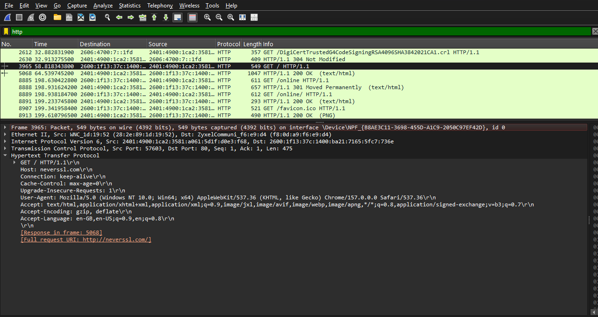
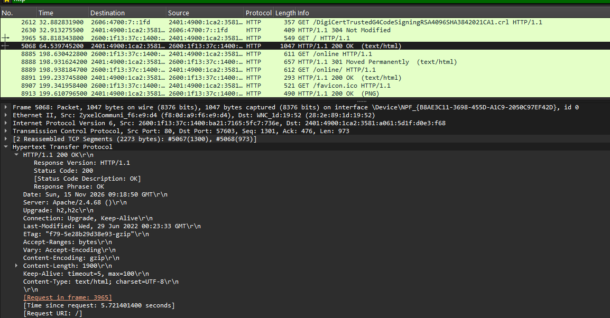
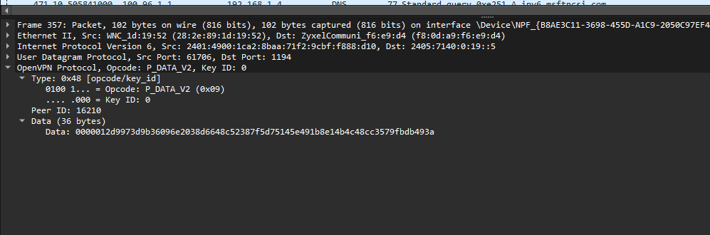
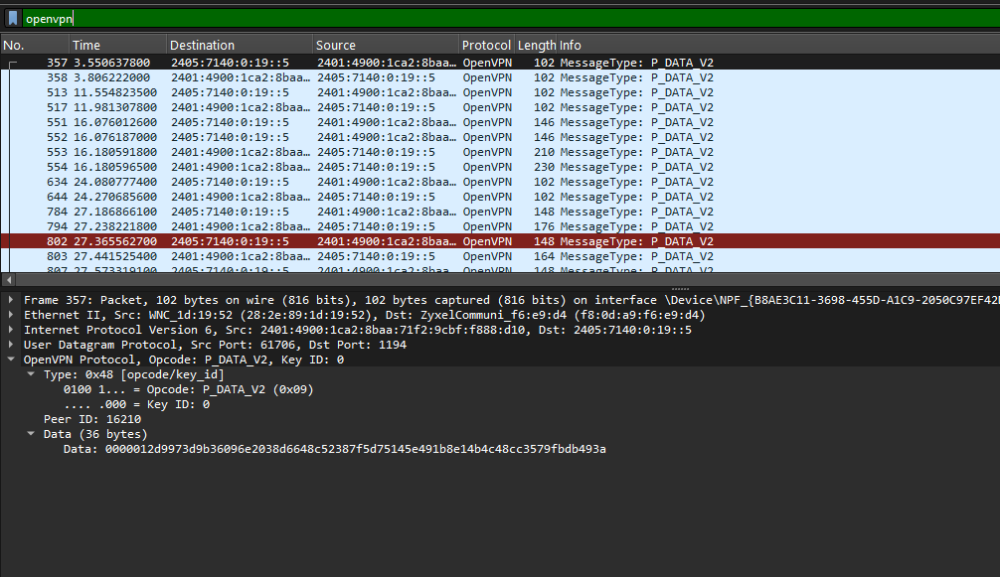

# Experiment 11: Comparison of VPN Traffic and Unencrypted Communication

## 1. Aim

To capture and examine unencrypted HTTP communication and OpenVPN traffic using Wireshark, compare their properties, and understand the impact of VPN encryption and split tunneling on network traffic.

## 2. Software and Tools Required

- **Operating System:** Windows 11
- **Packet Analyzer:** Wireshark
- **Web Browser:** Google Chrome
- **VPN Client:** OpenVPN Connect
- **VPN Service:** OpenVPN CloudConnexa
- **Websites:** `http://neverssl.com` and `http://example.com`
- **Code Editor:** Visual Studio Code

## 3. Theory

### 3.1 Unencrypted HTTP Communication

HTTP (Hypertext Transfer Protocol) is an application-layer protocol that enables communication between web browsers and web servers.

When HTTP operates without TLS encryption, the exchanged request and response information can be viewed by anyone capable of capturing the network packets.

Using Wireshark, the following information can be examined:

- HTTP request method
- Requested URL
- Host header
- HTTP response status
- Other transmitted headers and data

### 3.2 Virtual Private Network (VPN)

A Virtual Private Network (VPN) establishes an encrypted connection, commonly called a tunnel, between a user's device and a VPN server.

It helps prevent external observers on the underlying network from directly reading the information transmitted through this encrypted tunnel.

However, VPN protection is limited to the network traffic that is actually directed through the VPN connection.

### 3.3 OpenVPN Protocol

OpenVPN is a VPN protocol that provides encrypted communication for transferring network data securely.

In this experiment, Wireshark detected OpenVPN communication through UDP port **1194**.

The captured OpenVPN packets contained the following characteristics:

- Protocol: OpenVPN
- Packet type: `P_DATA_V2`
- UDP destination port: `1194`
- Encrypted-looking binary payload

### 3.4 Split Tunneling

Split tunneling is a VPN feature that allows only selected network traffic to travel through the VPN tunnel.

The remaining internet traffic continues to use the device's regular internet connection.

Therefore, simply connecting to a VPN does not guarantee that every internet connection will be encrypted through that VPN.

## 4. Working Procedure

### Part A: Capturing Unencrypted HTTP Traffic

**Step 1:** Launch Wireshark and choose the currently active Wi-Fi network interface.

**Step 2:** Begin capturing network packets.

**Step 3:** Open Google Chrome using Incognito mode.

**Step 4:** Enter the following website in the browser:

`http://neverssl.com`

**Step 5:** Return to Wireshark and stop the packet capture.

**Step 6:** Enter the following display filter:

```text
http
```

**Step 7:** Locate an HTTP GET request and expand the Hypertext Transfer Protocol section.

**Step 8:** Examine the request method, host information, headers, and server response.

**Step 9:** Store the captured packets using the following filename:

`unencrypted_baseline.pcapng`

### Part B: Establishing an OpenVPN Connection

**Step 1:** Download, install, and launch OpenVPN Connect.

**Step 2:** Set up the VPN connection with OpenVPN CloudConnexa.

**Step 3:** Establish the VPN connection.

**Step 4:** Confirm that OpenVPN Connect displays the following connection status:

`Securely Connected!`

### Part C: Capturing VPN Network Traffic

**Step 1:** Start a fresh packet capture in Wireshark using the active Wi-Fi interface.

**Step 2:** Keep the VPN connection active and open the following website:

`http://example.com`

**Step 3:** Stop the packet capture after generating the network traffic.

**Step 4:** Apply the following HTTP display filter:

```text
http
```

**Step 5:** Check whether HTTP packets can still be seen in the captured traffic.

**Step 6:** Now enter the OpenVPN display filter:

```text
openvpn
```

**Step 7:** Select any OpenVPN packet and examine its protocol information and payload.

**Step 8:** Save the captured network traffic with the following name:

`vpn_encrypted_capture.pcapng`

## 5. Captured Packet Details

### 5.1 Unencrypted HTTP Request

The initial HTTP capture provided the following packet information:

| Field | Observed Value |
|---|---|
| Packet number | 3965 |
| Protocol | HTTP |
| Request method | GET |
| Request URI | `/` |
| Host | `neverssl.com` |
| Full request URI | `http://neverssl.com/` |
| Destination TCP port | 80 |
| Encryption | No HTTP-layer encryption |

The captured HTTP request and its associated headers were directly readable in Wireshark.

### 5.2 HTTP Response

The details of the received HTTP response were as follows:

| Field | Observed Value |
|---|---|
| Packet number | 5068 |
| Protocol | HTTP |
| Status | `200 OK` |
| Content-Type | `text/html; charset=UTF-8` |
| Server | Apache/2.4.68 |

This observation confirmed that the HTTP response headers were also visible during packet analysis.

### 5.3 OpenVPN Packet

The captured OpenVPN packet contained the following information:

| Field | Observed Value |
|---|---|
| Packet number | 357 |
| Protocol | OpenVPN |
| Transport protocol | UDP |
| UDP source port | 61706 |
| UDP destination port | 1194 |
| OpenVPN packet type | `P_DATA_V2` |
| Key ID | 0 |
| Peer ID | 16210 |
| Data length | 36 bytes |

Wireshark recognized the captured packet as OpenVPN communication instead of displaying it as a readable HTTP request.

### 5.4 HTTP Traffic Captured During an Active VPN Connection

Even after establishing the VPN connection, Wireshark detected the following HTTP request:

| Field | Observed Value |
|---|---|
| Packet number | 1509 |
| Protocol | HTTP |
| Source IP | 192.168.1.4 |
| Destination IP | 104.20.23.154 |
| Request method | GET |
| Host | `example.com` |
| Full request URI | `http://example.com/` |
| Destination TCP port | 80 |

An HTTP server response containing the status `200 OK` was also found in packet **1514**.

This observation indicated that the HTTP request sent to `example.com` was not passing through the OpenVPN tunnel under the configuration used in this experiment.

## 6. Screenshots

### Screenshot 1: Unencrypted HTTP Request



**Observation:** The HTTP GET request and the `Host: neverssl.com` header could be viewed directly in Wireshark.

### Screenshot 2: Unencrypted HTTP Response



**Observation:** Wireshark showed the server's HTTP response status as `200 OK`, along with other response headers.

### Screenshot 3: OpenVPN Packet Analysis



**Observation:** The captured packet was recognized as an OpenVPN `P_DATA_V2` message transmitted through UDP port 1194.

### Screenshot 4: OpenVPN Traffic



**Observation:** Multiple VPN-related packets appeared after applying the `openvpn` display filter.

## 7. Analysis and Observations

### 7.1 Comparison Between HTTP and OpenVPN Traffic

The following table highlights the major differences observed between unencrypted HTTP communication and OpenVPN tunnel traffic.

| Parameter | Unencrypted HTTP | OpenVPN Tunnel Traffic |
|---|---|---|
| Protocol observed | HTTP | OpenVPN |
| Transport observed | TCP | UDP |
| Port observed | 80 | 1194 |
| HTTP request headers | Readable | Not directly readable inside captured VPN packets |
| Payload appearance | Readable HTTP fields | Binary VPN payload |
| Encryption | No HTTP-layer encryption | VPN tunnel uses encryption |
| Wireshark filter | `http` | `openvpn` |

### 7.2 Important Finding: Split Tunneling

The OpenVPN connection was established successfully through OpenVPN Connect.

However, the CloudConnexa dashboard showed the following configuration:

**Split Tunnel On**

Additionally, the Windows routing table indicated that the default internet route was still using the local Wi-Fi gateway.

While the VPN was active, Wireshark continued to display the following HTTP request information:

`GET / HTTP/1.1`

`Host: example.com`

This observation indicates that the HTTP request was sent through the regular internet connection rather than being transferred through the VPN tunnel.

**Therefore, this experiment demonstrated that encrypted VPN communication and unencrypted HTTP communication can occur simultaneously through the same network interface.**

### 7.3 Difference Between Expected and Actual Results

According to the expected laboratory procedure, enabling the VPN should prevent readable HTTP packets from appearing when the `http` filter is applied.

However, the actual packet capture showed that HTTP requests and responses were still visible.

This unexpected result was caused by the split-tunneling configuration enabled in the VPN settings.

It also demonstrates why checking the network routing configuration is important instead of assuming that all internet traffic is protected merely because the VPN client shows a successful connection.

## 8. Result

The experiment was successfully performed using Wireshark, and the following network traffic was captured and analyzed:

1. Unencrypted HTTP request and response packets were captured and examined.
2. OpenVPN packets transmitted through UDP were identified.
3. HTTP communication that remained visible while the VPN connection was active was observed.

The captured packets clearly demonstrated the difference between readable HTTP communication and OpenVPN tunnel traffic.

Furthermore, the experiment verified that the enabled split-tunneling configuration allowed some internet traffic to bypass the VPN connection.

## 9. Conclusion

This experiment explained the process of capturing and analyzing unencrypted HTTP communication and OpenVPN traffic using Wireshark.

The HTTP packet capture revealed readable request and response information, whereas the OpenVPN capture displayed VPN protocol packets containing binary payloads.

One significant observation was that split tunneling was enabled in the VPN configuration. Due to this setting, the HTTP request to `example.com` remained visible even when the VPN connection was active.

Thus, the experiment established that VPN security depends not only on creating an encrypted tunnel but also on correctly routing the required network traffic through that tunnel.

## 10. Security Note

- HTTP communication without TLS encryption can expose transmitted information.
- VPN encryption provides protection to network traffic routed through the VPN tunnel.
- Split tunneling may allow certain network connections to bypass VPN protection.
- A successful VPN connection does not automatically guarantee that all network traffic is protected.
- Packet capture files can contain confidential network information and must be stored and handled securely.

**Note:** The original `.pcapng` packet capture files and VPN configuration files have not been included in this repository.