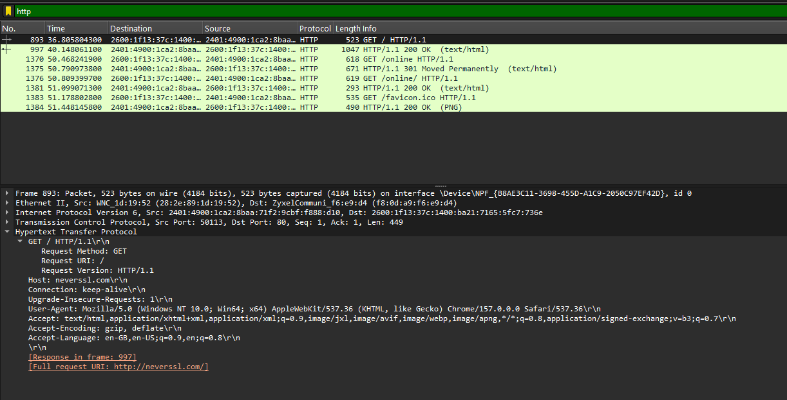
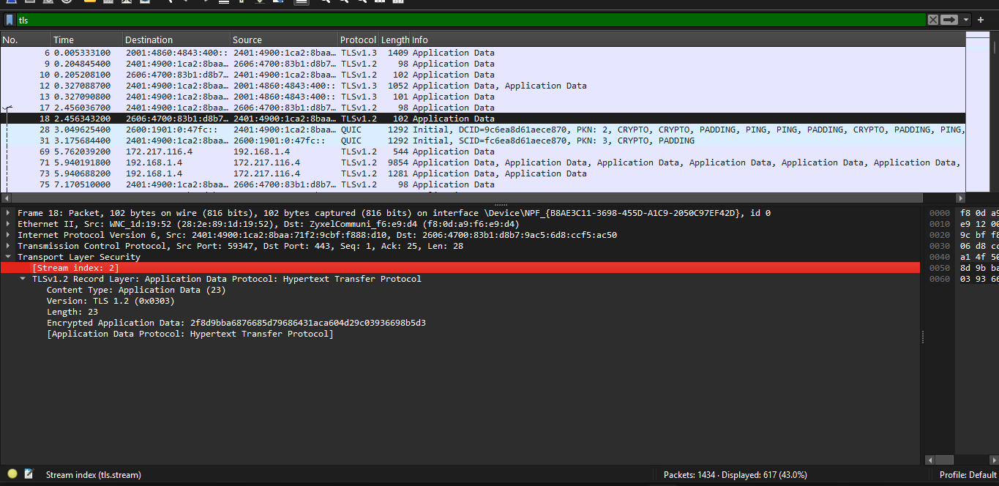
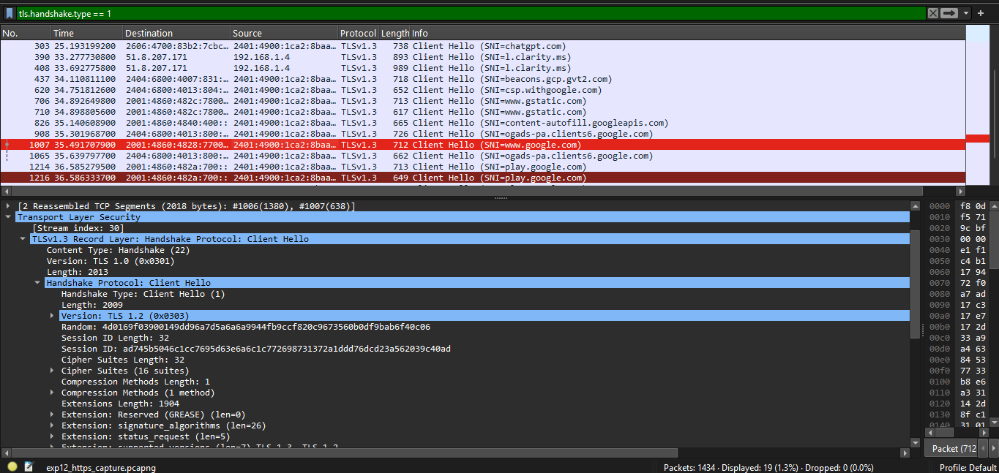
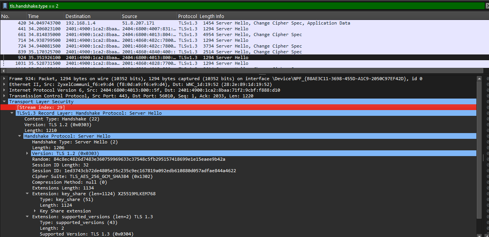

# Experiment 12: Examination of Secure and Insecure Communication Protocols Using Wireshark

## 1. Aim

To capture and examine HTTP and HTTPS network traffic through Wireshark and understand the differences between secure and insecure communication protocols.

## 2. Tools Required

- Wireshark
- Google Chrome
- Internet Connection
- Windows 11

## 3. Theory

### HTTP (Hypertext Transfer Protocol)

HTTP is an application-layer protocol that enables data exchange between web browsers and web servers.

It does not include encryption by default. As a result, transmitted information, such as HTTP headers and application data, can be viewed in readable plaintext during network packet analysis.

**Default Port:** 80

### HTTPS (Hypertext Transfer Protocol Secure)

HTTPS is a secure communication protocol that uses Transport Layer Security (TLS) to establish protected communication between a client and a server.

TLS provides encryption to application data and helps maintain its confidentiality and integrity while being transmitted over a network.

**Default Port:** 443

## 4. Procedure

### Part A: Examining Insecure HTTP Communication

**Website:** `http://neverssl.com/`

1. Launch the Wireshark application.
2. Choose the currently active Wi-Fi network interface.
3. Begin capturing network packets.
4. Open `http://neverssl.com/` using Google Chrome.
5. Once the website has loaded, stop the packet capture.
6. Enter the following display filter in Wireshark:

```text
http
```

7. Find and select an HTTP GET request packet.
8. Expand the Hypertext Transfer Protocol section.
9. Examine the request method, host name, URI, and other HTTP header information.

**Observation:**

The captured HTTP request headers were displayed in readable plaintext format.

The packet contained the following information:

- Request Method: GET
- Request URI: /
- HTTP Version: HTTP/1.1
- Host: neverssl.com
- Destination Port: 80

### Screenshot 1: HTTP Request Headers



---

### Part B: Examining Secure HTTPS Communication

**Website:** `https://www.google.com/`

1. Begin a fresh packet capture in Wireshark.
2. Visit `https://www.google.com/` through Google Chrome.
3. Stop the packet capture after the website finishes loading.
4. Enter the following display filter:

```text
tls
```

5. Locate and select a TLS Application Data packet.
6. Expand the Transport Layer Security section.
7. Examine the encrypted application information.
8. Identify and inspect the Client Hello and Server Hello handshake messages.

### Screenshot 2: TLS Encrypted Application Data

**Display Filter:**

```text
tls
```

**Observation:**

The selected TLS Application Data packet contained encrypted application information.

- Protocol: TLSv1.2
- Content Type: Application Data (23)
- Destination Port: 443
- Application Data: Encrypted

The actual application content was protected and could not be directly interpreted as readable plaintext.



---

### Screenshot 3: TLS Client Hello

**Display Filter:**

```text
tls.handshake.type == 1
```

**Observation:**

The Client Hello handshake message was located successfully in the captured packets.

- Handshake Type: Client Hello (1)
- Server Name: www.google.com
- Protocol: TLSv1.3
- Destination Port: 443

The Client Hello message carries the information required by the client to initiate and negotiate a secure TLS connection.



---

### Screenshot 4: TLS Server Hello

**Display Filter:**

```text
tls.handshake.type == 2
```

**Observation:**

The Server Hello handshake message was successfully detected.

- Handshake Type: Server Hello (2)
- Negotiated TLS Version: TLS 1.3
- Cipher Suite: TLS_AES_256_GCM_SHA384
- Source Port: 443

The Server Hello message provides the connection parameters selected by the server for establishing secure communication.



---

## 5. Comparison of HTTP and HTTPS

| Feature | HTTP – NeverSSL | HTTPS – Google |
|---|---|---|
| Default Port | 80 | 443 |
| Encryption | No built-in encryption | TLS encryption |
| Application Data | Can be viewed in plaintext | Encrypted during transmission |
| Confidentiality | Not provided by HTTP itself | Provided by TLS when correctly configured |
| Packet Analysis | HTTP headers and content can be readable | TLS handshake and connection metadata may be visible |
| Security | Susceptible to eavesdropping and modification | Helps prevent eavesdropping and tampering during transmission |

## 6. Result

HTTP communication from NeverSSL and HTTPS communication from Google were successfully captured and analyzed using Wireshark.

The HTTP packet capture revealed that request headers were directly readable in plaintext.

In contrast, the HTTPS packet capture displayed TLS handshake messages and encrypted application data.

The experiment confirmed that HTTP does not provide encryption by default, whereas HTTPS uses TLS to secure application data during network transmission.

## 7. Precautions

- Capture network packets only from authorized networks.
- Always choose the correct active network interface before starting the capture.
- Generate website traffic while Wireshark is recording packets.
- Apply the correct display filters to examine HTTP and TLS communication.