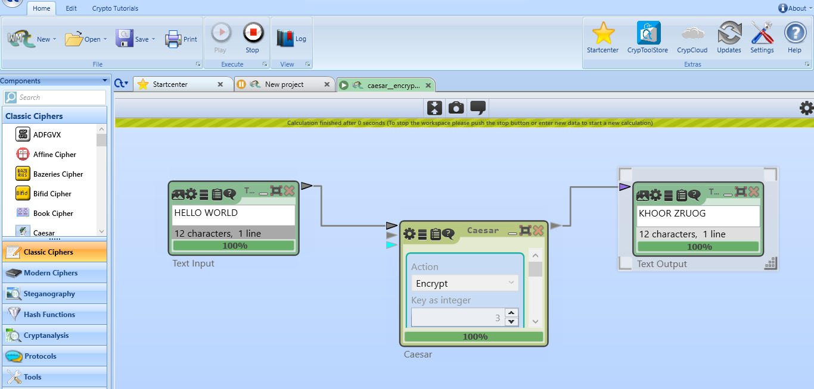
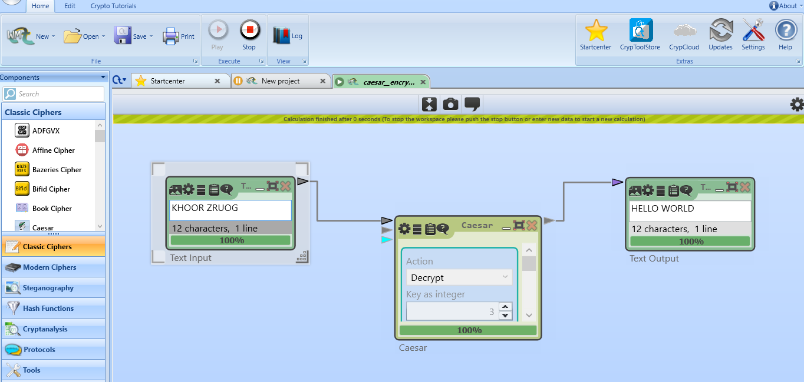
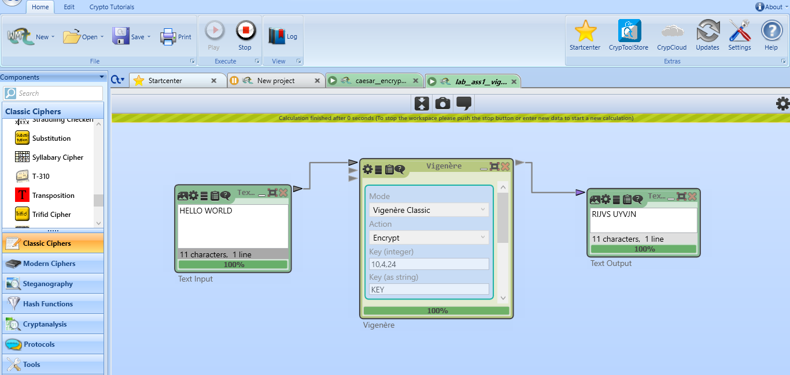
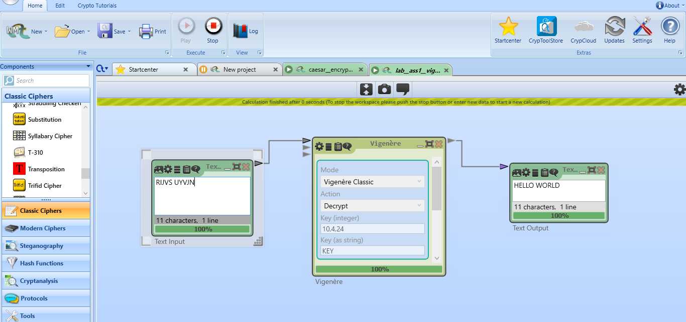
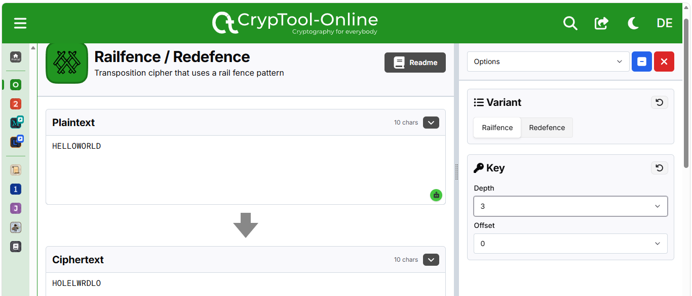
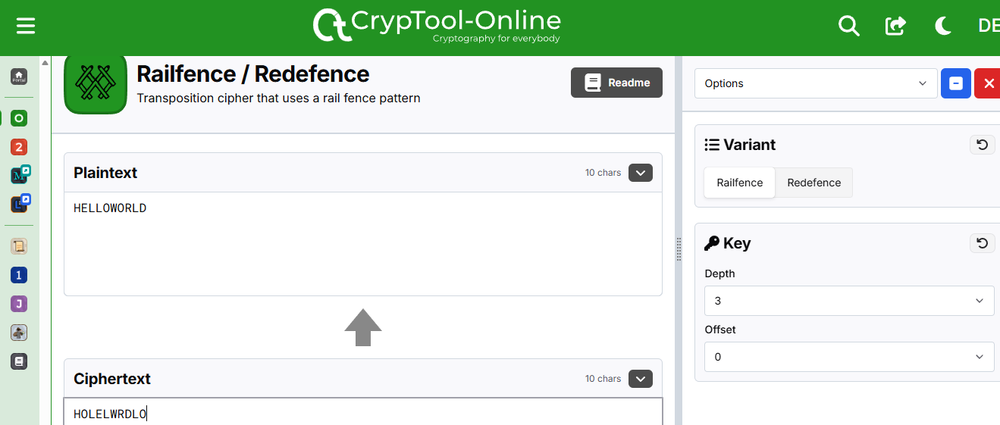

# Experiment 1: Implementation of Caesar, Vigenère, and Rail Fence Ciphers

## 1. Aim

To perform encryption and decryption using Caesar, Vigenère, and Rail Fence ciphers with the plaintext `HELLO WORLD` and study their techniques and security limitations.

## 2. Software/Tools Required

* CrypTool 2 – for implementing Caesar and Vigenère ciphers.
* CrypTool Online – for implementing the Rail Fence cipher.
* Web browser.

## 3. Algorithms

### A. Caesar Cipher

1. Select `HELLO WORLD` as the input plaintext.
2. Choose a shift key of 3.
3. Replace every letter with the letter located three positions ahead in the alphabet.
4. Preserve the space separating the words.
5. For decryption, move each ciphertext letter three positions backward to obtain the original text.

**Plaintext:** `HELLO WORLD`

**Key:** `3`

**Ciphertext:** `KHOOR ZRUOG`

### B. Vigenère Cipher

1. Use `HELLO WORLD` as the plaintext.
2. Select `KEY` as the encryption keyword.
3. Repeat the keyword across the plaintext letters, excluding spaces when applying the key.
4. Encrypt each letter by shifting it according to the corresponding keyword letter.
5. Combine the encrypted letters to produce the final ciphertext.
6. To decrypt, apply the reverse shifts using the same keyword.

**Plaintext:** `HELLO WORLD`

**Key:** `KEY`

**Ciphertext:** `RIJVS UYVJN`

### C. Rail Fence Cipher

1. Remove the space from the plaintext to obtain `HELLOWORLD`.
2. Select a depth of 3 rails.
3. Write the plaintext letters in a zigzag arrangement across the three rails.
4. Read the characters row by row to generate the ciphertext.
5. For decryption, reconstruct the zigzag pattern using the same depth and restore the original letter sequence.

**Plaintext:** `HELLOWORLD`

**Depth:** `3`

**Offset:** `0`

**Ciphertext:** `HOLELWRDLO`

## 4. Working Procedure

### A. Caesar Cipher

1. Launch CrypTool 2.
2. Open the Caesar Cipher component or an appropriate workspace.
3. Enter `HELLO WORLD` into the plaintext input.
4. Configure the shift value as 3.
5. Execute the encryption process and note the generated ciphertext.
6. Use the same shift value to decrypt the ciphertext.
7. Check whether the decrypted output matches the original plaintext.

### B. Vigenère Cipher

1. Start CrypTool 2 and open the Vigenère Cipher component.
2. Enter `HELLO WORLD` as the input message.
3. Set the encryption keyword to `KEY`.
4. Run the encryption process and record the ciphertext.
5. Use the same keyword to perform decryption.
6. Examine the decrypted output.
7. Confirm that the original plaintext has been recovered correctly.

### C. Rail Fence Cipher

1. Open the Rail Fence Cipher tool on CrypTool Online.
2. Enter `HELLOWORLD` as the plaintext.
3. Configure the rail depth to 3 and the offset to 0, if the tool supports this setting.
4. Execute encryption and note the resulting ciphertext.
5. Enter the ciphertext into the decryption tool and specify the same depth.
6. Run the decryption process.
7. Verify that the resulting plaintext is `HELLOWORLD`.

## 5. Screenshots of Tool Setup and Output

### A. Caesar Cipher

**Encryption Output**

**Decryption Output**

### B. Vigenère Cipher

**Encryption Output**

**Decryption Output**

### C. Rail Fence Cipher

**Encryption Output**

**Decryption Output**

## 6. Comparison of Working Methods and Effectiveness

| Cipher            | Working Method                                                                   | Effectiveness                                                                                              |
| ----------------- | -------------------------------------------------------------------------------- | ---------------------------------------------------------------------------------------------------------- |
| Caesar Cipher     | Encrypts each letter by shifting it a fixed number of positions in the alphabet. | Easy to understand and implement, but weak because it has very few possible keys.                          |
| Vigenère Cipher   | Encrypts letters using shifts determined by a repeating keyword.                 | More resistant to simple frequency analysis than Caesar, but vulnerable when the key is short or repeated. |
| Rail Fence Cipher | Rearranges plaintext letters in a zigzag pattern and reads them row by row.      | Simple to implement, but provides limited security because it only changes letter positions.               |

### Explanation

* **Caesar Cipher:** Encrypts text by applying the same fixed shift to every letter.
* **Vigenère Cipher:** Uses a repeating keyword to determine different shifts for individual letters.
* **Rail Fence Cipher:** Preserves the original letters but changes their arrangement according to a zigzag pattern.

Among these three classical techniques, the Vigenère Cipher generally offers better resistance to simple frequency-based attacks than the Caesar Cipher. The Rail Fence Cipher provides only transposition-based encryption and offers weak protection.

However, none of these classical ciphers is suitable for protecting sensitive information in modern communication systems.

## 7. Result

The Caesar, Vigenère, and Rail Fence ciphers were successfully studied through encryption and decryption exercises. Their operating principles and security limitations were compared.

The experiment demonstrated that Caesar encryption uses a fixed alphabetic shift, Vigenère encryption relies on a repeating keyword, and Rail Fence encryption rearranges the positions of letters. It also highlighted the limitations of classical ciphers in providing modern information security.
