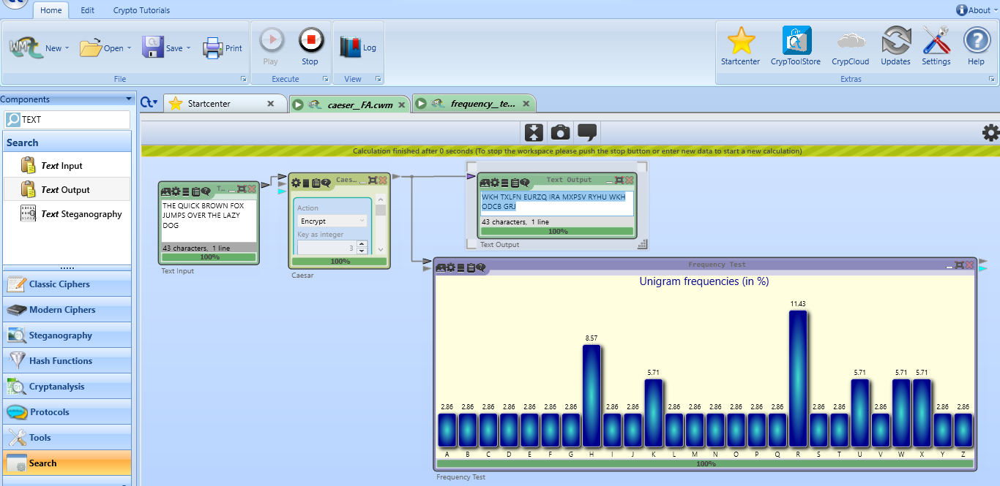
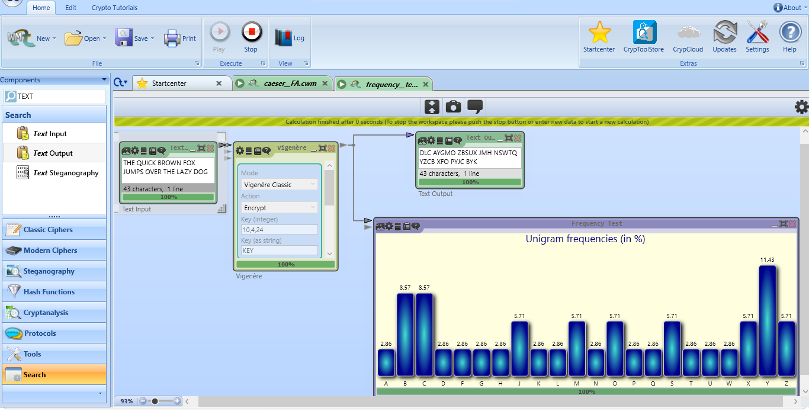

# Experiment 2: Frequency Analysis of Classical Ciphers

## 1. Aim

To examine the frequency of letters in classical encrypted messages and evaluate their susceptibility to cryptanalysis using CrypTool 2.

## 2. Software/Tool Required

* CrypTool 2

## 3. Theory

Frequency analysis is a cryptanalysis method that examines the occurrence of letters in an encrypted text. In the English language, letters such as E, T, A, O, and I appear more frequently than most other letters.

By comparing the letter distribution of ciphertext with the typical frequency distribution of English text, an attacker can make assumptions about the original plaintext.

This technique is particularly effective against substitution ciphers, such as the Caesar Cipher, because each letter is consistently replaced by another letter. The Vigenère Cipher provides greater resistance to basic frequency analysis because it uses a repeating keyword to apply different shifts to the plaintext letters.

## 4. Working Procedure

### A. Caesar Cipher

1. Launch CrypTool 2 on the computer.
2. Enter the plaintext `THE QUICK BROWN FOX JUMPS OVER THE LAZY DOG`.
3. Add and configure the Caesar Cipher component.
4. Set the encryption shift to `3`.
5. Encrypt the input text and obtain the resulting ciphertext.
6. Apply the Frequency Test to analyze the encrypted message.
7. Examine the frequency histogram and note the occurrence of individual letters.

**Plaintext:**

`THE QUICK BROWN FOX JUMPS OVER THE LAZY DOG`

**Key:** `3`

**Ciphertext:**

`WKH TXLFN EURZQ IRA MXPSV RYHU WKH ODCB GRJ`

### B. Vigenère Cipher

1. Start CrypTool 2 and create a workspace.
2. Enter the same plaintext used in the Caesar Cipher experiment.
3. Insert the Vigenère Cipher component.
4. Specify `KEY` as the encryption keyword.
5. Execute the encryption process to generate the ciphertext.
6. Apply the Frequency Test to the encrypted output.
7. Study the histogram and record the frequency of each letter.

**Plaintext:**

`THE QUICK BROWN FOX JUMPS OVER THE LAZY DOG`

**Key:** `KEY`

**Ciphertext:**

`DLC AYGMO ZBSUX JMH NSWTQ YZCB XFO PYJC BYK`

## 5. Screenshots of Tool Setup and Output

### A. Caesar Cipher Frequency Analysis

The screenshot illustrates the encrypted output produced by the Caesar Cipher and its corresponding letter-frequency histogram.

### B. Vigenère Cipher Frequency Analysis

The screenshot displays the Vigenère Cipher output along with the histogram used to examine its letter distribution.

## 6. Comparison and Vulnerability Analysis

### A. Caesar Cipher

The ciphertext contains 35 letters when spaces are excluded.

| Letter                       | Frequency | Percentage |
| ---------------------------- | --------: | ---------: |
| R                            |         4 |     11.43% |
| H                            |         3 |      8.57% |
| K, U, W, X                   |    2 each | 5.71% each |
| Other letters occurring once |    1 each | 2.86% each |

The frequency histogram represents the number of times each letter appears in the ciphertext. Since the Caesar Cipher applies the same shift to every letter, the original frequency distribution is preserved, although the letters are replaced.

Consequently, an attacker can analyze the letter frequencies and use the results to help recover the plaintext. This makes the Caesar Cipher vulnerable to frequency-based attacks.

### B. Vigenère Cipher

The ciphertext contains 35 letters when spaces are excluded.

| Letter                       | Frequency | Percentage |
| ---------------------------- | --------: | ---------: |
| Y                            |         4 |     11.43% |
| B, C                         |    3 each | 8.57% each |
| J, M, O, S, X, Z             |    2 each | 5.71% each |
| Other letters occurring once |    1 each | 2.86% each |

The Vigenère Cipher uses a repeating keyword to encrypt letters with different shifts. As a result, the relationship between plaintext and ciphertext letter frequencies becomes less straightforward.

This makes simple frequency analysis less effective than it is against the Caesar Cipher. However, the Vigenère Cipher is not completely secure and can be broken using more advanced cryptanalysis methods.

### C. Comparison Between Caesar and Vigenère Ciphers

| Feature                | Caesar Cipher                                  | Vigenère Cipher                                      |
| ---------------------- | ---------------------------------------------- | ---------------------------------------------------- |
| Encryption Key         | Fixed shift of 3                               | Keyword `KEY`                                        |
| Encryption Technique   | Each letter is shifted by a fixed amount       | Letters are shifted according to a repeating keyword |
| Frequency Distribution | Easier to analyze                              | Generally more complex                               |
| Vulnerability          | Highly vulnerable to simple frequency analysis | More resistant to basic frequency analysis           |

**Analysis:**

The Caesar Cipher is easier to break because every letter undergoes the same fixed shift. In contrast, the Vigenère Cipher uses a repeating keyword to apply different shifts, making the original letter-frequency patterns less obvious.

Nevertheless, the Vigenère Cipher can still be attacked using techniques such as key-length analysis and more advanced frequency analysis.

## 7. Result

Frequency analysis was successfully performed on Caesar and Vigenère ciphertexts using CrypTool 2. The experiment demonstrated that the Caesar Cipher is more susceptible to simple frequency-based attacks because it uses a fixed substitution pattern.

The Vigenère Cipher provides better resistance to basic frequency analysis by applying different shifts through a repeating keyword. However, it remains vulnerable to advanced cryptanalysis techniques.
