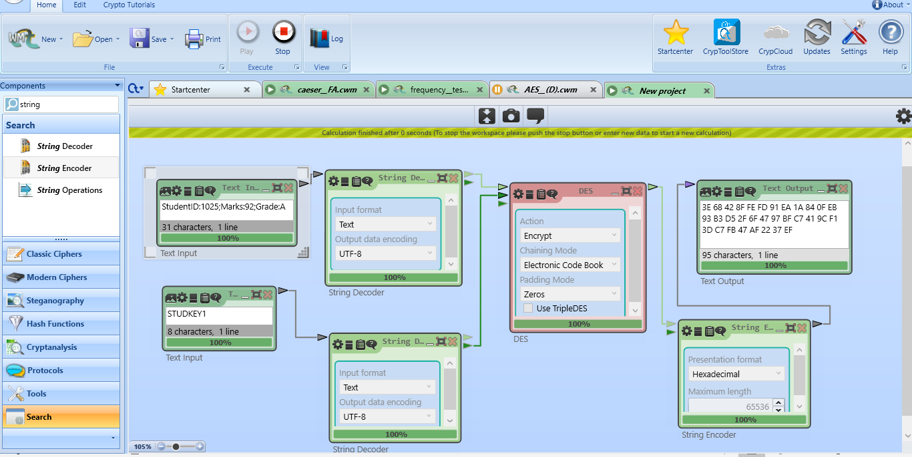
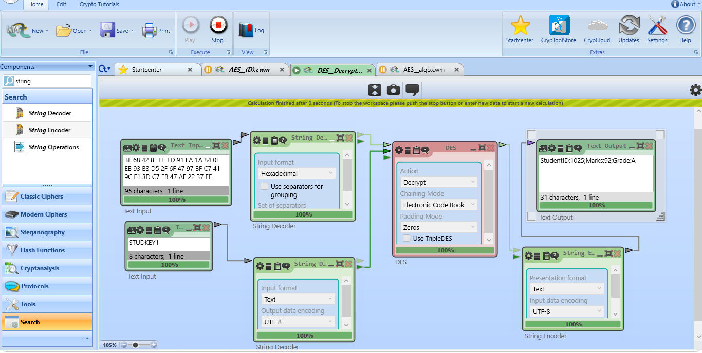
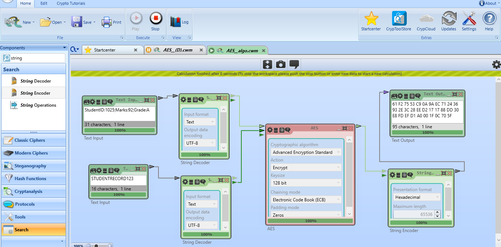
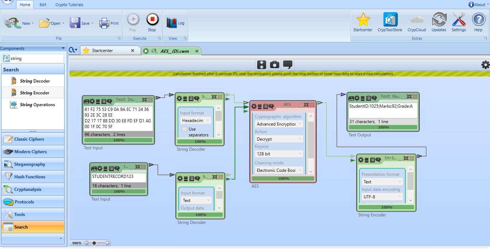

# Experiment 3: DES and AES Encryption

## 1. Aim

To perform encryption and decryption using DES and AES algorithms in CrypTool 2 and examine their differences in terms of security and performance.

## 2. Software/Tool Required

* CrypTool 2

## 3. Theory

**DES (Data Encryption Standard):**

DES is a symmetric-key encryption algorithm that uses the same secret key for both encryption and decryption. It operates on 64-bit data blocks and has an effective key length of 56 bits. Due to its short key length, DES is vulnerable to brute-force attacks and is no longer considered secure for modern applications.

**AES (Advanced Encryption Standard):**

AES is a symmetric encryption algorithm that uses the same secret key for encryption and decryption. It supports key lengths of 128, 192, and 256 bits and processes data in 128-bit blocks. AES offers stronger security than DES and is widely adopted in modern information security systems.

Both DES and AES transform readable plaintext into an unreadable form called ciphertext during encryption. Decryption reverses this process and restores the original plaintext when the correct key and encryption settings are provided.

## 4. Working Procedure

### A. DES Encryption

1. Launch CrypTool 2 and create a new workspace.
2. Insert two String Decoder components, a DES Encryption component, and a String Encoder component.
3. Configure the first String Decoder to use Text format and enter the plaintext.
4. Configure the second String Decoder to use Text format and provide the DES key.
5. Connect the plaintext and key outputs to the corresponding inputs of the DES Encryption component.
6. Connect the encrypted output to the String Encoder and choose Hexadecimal format.
7. Execute the workspace and examine the resulting ciphertext.

**Plaintext:**

`StudentID:1025;Marks:92;Grade:A`

**DES Key:**

`STUDKEY1`

**Ciphertext (Hexadecimal):**

`3E 68 42 8F FE FD 91 EA 1A 84 0F EB 93 B3 D5 2F 6F 47 97 BF C7 41 9C F1 3D C7 FB 47 AF 22 37 EF`

### B. DES Decryption

1. Insert a String Decoder component and configure it for Hexadecimal input.
2. Provide the previously generated DES ciphertext.
3. Connect the decoded ciphertext to the DES Decryption component.
4. Enter the same DES key, `STUDKEY1`, and retain the encryption mode and padding configuration used earlier.
5. Connect the decrypted output to a String Encoder configured for Text format.
6. Execute the workspace and check whether the original plaintext is restored.

### C. AES Encryption

1. Start a new workspace in CrypTool 2.
2. Add two String Decoder components, an AES Encryption component, and a String Encoder component.
3. Configure the plaintext decoder to Text format and enter the sample message.
4. Configure the key decoder to Text format and enter the AES key.
5. Set the AES key length to 128 bits.
6. Connect the plaintext and key outputs to the AES Encryption component.
7. Send the encrypted output to the String Encoder and select Hexadecimal format.
8. Run the workspace and record the generated ciphertext.

**Plaintext:**

`StudentID:1025;Marks:92;Grade:A`

**AES Key:**

`STUDENTRECORD123`

**Key Size:** 128 bits

**Ciphertext (Hexadecimal):**

`61 F2 75 53 C9 0A 9A EC 71 24 36 93 2E 3C 28 EE D2 17 17 88 DD 30 E8 FD EF D1 A0 00 1F 0C 70 5F`

### D. AES Decryption

1. Add a String Decoder component and select Hexadecimal format.
2. Enter the ciphertext obtained from the AES encryption process.
3. Connect the decoded ciphertext to the AES Decryption component.
4. Provide the same AES key, `STUDENTRECORD123`, and select a key length of 128 bits.
5. Ensure that the encryption mode and padding settings match those used during encryption.
6. Connect the decrypted output to a String Encoder configured for Text format.
7. Execute the workspace and verify that the original message is recovered.

## 5. Screenshots of Tool Setup and Output

### A. DES Encryption

### B. DES Decryption

### C. AES Encryption

### D. AES Decryption

## 6. Comparison of DES and AES

| Feature                | DES                                             | AES                                                                  |
| ---------------------- | ----------------------------------------------- | -------------------------------------------------------------------- |
| Full Form              | Data Encryption Standard                        | Advanced Encryption Standard                                         |
| Effective Key Length   | 56 bits                                         | 128, 192, or 256 bits                                                |
| Block Size             | 64 bits                                         | 128 bits                                                             |
| Security Level         | Insecure for modern applications                | Strong when properly implemented                                     |
| Brute-Force Resistance | Weak due to its short key                       | Stronger due to longer keys                                          |
| Performance            | Efficient in some legacy or specialized systems | Efficient on modern systems, particularly with hardware acceleration |
| Current Applications   | Primarily educational and legacy purposes       | Widely used in modern security applications                          |

### Security Analysis

DES is vulnerable to brute-force attacks because its effective key length is only 56 bits. In comparison, AES provides significantly stronger protection by supporting longer key lengths. Therefore, AES is the preferred choice for securing modern digital information.

### Performance Analysis

Both algorithms support encryption and decryption, but their actual execution speed depends on the hardware, software implementation, encryption mode, and available processor features.

AES generally performs efficiently on modern computers, particularly when hardware acceleration is available. The recorded ciphertext outputs demonstrate the encryption process but do not, by themselves, establish which algorithm executes faster.

## 7. Result

The sample student record was processed using DES and AES encryption and decryption in CrypTool 2. The experiment demonstrated that the original plaintext can be recovered using the appropriate secret key and matching encryption settings.

The comparison showed that AES provides stronger security than DES because of its longer key sizes and greater resistance to brute-force attacks. Hence, AES is more suitable for modern data protection.
