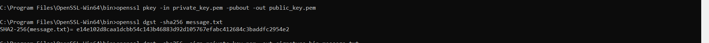
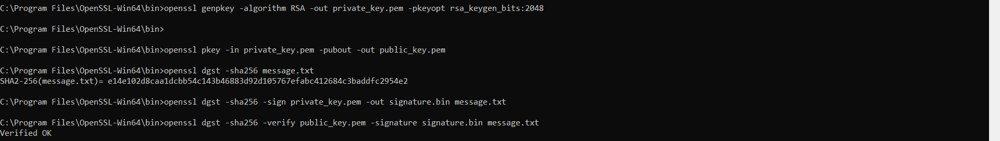
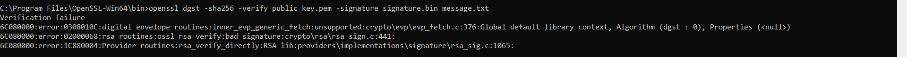

# Experiment 5: SHA-256 Hashing and Digital Signature Verification Using OpenSSL

## 1. Aim

To calculate SHA-256 message hashes, generate RSA digital signatures, and validate their authenticity and integrity using OpenSSL.

## 2. Software/Tools Required

* OpenSSL 4.0.1
* Windows Command Prompt (CMD)

## 3. Theory

**SHA-256 Hashing:**

SHA-256 is a cryptographic algorithm that transforms input data into a fixed-size hash value of 256 bits, typically represented by 64 hexadecimal characters. Even a minor alteration in the input message produces a different hash value with a very high probability. It is commonly used to check data integrity.

**Digital Signature:**

A digital signature is a cryptographic mechanism used to establish the authenticity and integrity of digital information. The sender generates the signature using a private key, while the receiver checks it using the corresponding public key.

**Signature Verification:**

Digital signature verification determines whether a signature is valid for a particular message. If the message remains unchanged and the signature is valid, OpenSSL displays `Verified OK`. If the message is altered after signing, the verification process fails.

## 4. Working Procedure

### Step 1: Prepare the Message File

A text file named `message.txt` was created containing the following text:

```text
This is a digital signature experiment.

StudentID:1025

Message:Verify authenticity using SHA-256.
```

### Step 2: Calculate the SHA-256 Hash

The following command was executed to calculate the message's SHA-256 hash:

```cmd
openssl dgst -sha256 message.txt
```

The resulting hash value was:

```text
e14e102d8caa1dcbb54c143b46883d92d105767efabc412684c3baddfc2954e2
```

### Step 3: Generate RSA Key Pairs

A 2048-bit RSA private key was created using the following command:

```cmd
openssl genpkey -algorithm RSA -out private_key.pem -pkeyopt rsa_keygen_bits:2048
```

The corresponding public key was extracted using:

```cmd
openssl rsa -pubout -in private_key.pem -out public_key.pem
```

### Step 4: Generate the Digital Signature

The message was digitally signed using the RSA private key and the SHA-256 algorithm:

```cmd
openssl dgst -sha256 -sign private_key.pem -out signature.bin message.txt
```

The generated digital signature was stored in `signature.bin`.

### Step 5: Verify the Digital Signature

The following command was used to validate the signature with the corresponding public key:

```cmd
openssl dgst -sha256 -verify public_key.pem -signature signature.bin message.txt
```

**Output:**

```text
Verified OK
```

This result confirmed that the signature was valid for the original message.

### Step 6: Verify Integrity After Modifying the Message

An additional line was inserted into `message.txt`, and the verification command was executed again.

OpenSSL displayed `Verification failure` because the modified message no longer matched the signed content.

After completing the test, the added line was deleted to restore the original message. Running the verification command again produced `Verified OK`.

## 5. Screenshots

### SHA-256 Hash Generation



### Digital Signature Generation and Verification



### Verification After Message Modification



## 6. Result

The SHA-256 hash value of the message was successfully calculated using OpenSSL. An RSA digital signature was generated with the private key and verified using the corresponding public key.

The verification process succeeded for the original message but failed after the message was modified. This demonstrated how SHA-256 and digital signatures help verify message integrity and authenticity.

Hence, the experiment was completed successfully.
