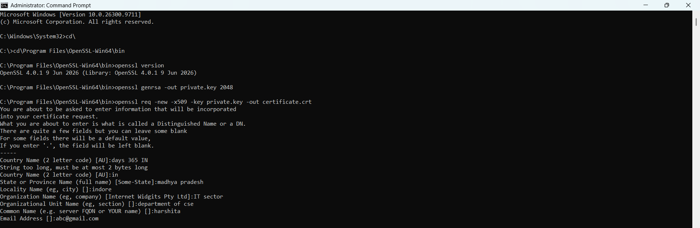
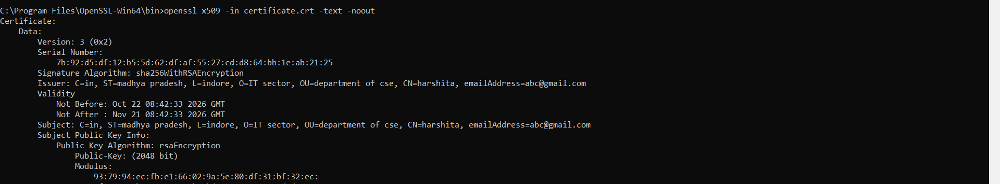
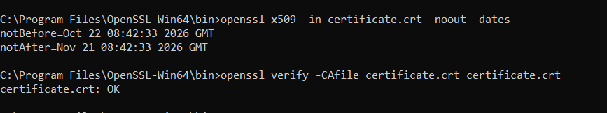

# Experiment 6: Creating and Analyzing a Self-Signed X.509 Digital Certificate Using OpenSSL

## Aim

To generate a self-signed X.509 digital certificate with OpenSSL and examine its properties, validity duration, and security characteristics.

## Software/Tools Required

* OpenSSL
* Windows Command Prompt (CMD)

## Theory

An **X.509 digital certificate** is an electronic document that associates an entity's identity with its public key. It includes details such as the subject's identity, issuer information, public key, validity dates, and digital signature.

A **self-signed certificate** is a certificate signed using its own corresponding private key rather than being issued and signed by an external Certificate Authority (CA).

**OpenSSL** is a cryptographic utility that provides commands for generating private keys, creating digital certificates, and examining certificate information.

## Working Procedure

### Step 1: Generate a Private Key

The following command generates a 2048-bit RSA private key:

```cmd
openssl genrsa -out private.key 2048
```

The generated private key is stored in a file named `private.key`.

### Step 2: Generate a Self-Signed Certificate

The following command creates a self-signed certificate with a validity duration of 365 days:

```cmd
openssl req -new -x509 -key private.key -out certificate.crt -days 365
```

During execution, the required information, including country, state, organization, organizational unit, and Common Name (CN), is entered when prompted.

The resulting certificate is saved in the file `certificate.crt`.

### Step 3: View Certificate Information

The following command displays the certificate's complete details:

```cmd
openssl x509 -in certificate.crt -text -noout
```

The command output provides information about the certificate version, serial number, issuer, subject, validity duration, public key, and signature algorithm.

### Step 4: Examine the Certificate Validity

The following command displays the certificate's validity dates:

```cmd
openssl x509 -in certificate.crt -noout -dates
```

The `notBefore` field specifies the date and time from which the certificate is valid, whereas the `notAfter` field indicates its expiration date and time.

### Step 5: Verify the Certificate

The following command checks the certificate by using it as its own trusted certificate:

```cmd
openssl verify -CAfile certificate.crt certificate.crt
```

**Expected Output:**

```text
certificate.crt: OK
```

This output indicates that OpenSSL successfully verified the certificate against the supplied trust certificate. It does not mean that the certificate is automatically trusted by browsers or external systems.

## Screenshots

### 1. Certificate Generation



### 2. Certificate Attributes



### 3. Certificate Validity and Verification



## Security Analysis

1. **Public Key:** The certificate stores the public key associated with the corresponding private key.

2. **Digital Signature:** The signature helps detect unauthorized modifications to the certificate and verify that it was signed using the corresponding private key.

3. **Validity Period:** The certificate is configured to remain valid for 365 days, subject to its specified validity dates.

4. **Self-Signed Certificate:** In a self-signed certificate, the issuer and subject fields generally contain the same identity.

5. **Private Key Protection:** The private key must be stored securely and should never be exposed publicly or uploaded to GitHub.

6. **Trust Limitation:** Self-signed certificates are not automatically trusted by web browsers, websites, or other systems unless the certificate is explicitly trusted.

## Result

A self-signed X.509 digital certificate was successfully created using OpenSSL. Its attributes, public key information, and validity period were examined. The verification command returned `certificate.crt: OK`, confirming that the certificate passed the verification check using the supplied certificate as its own trust anchor.
