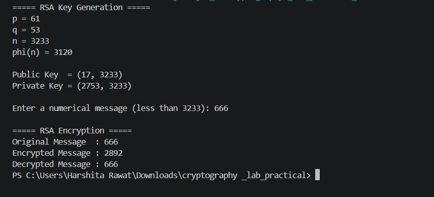
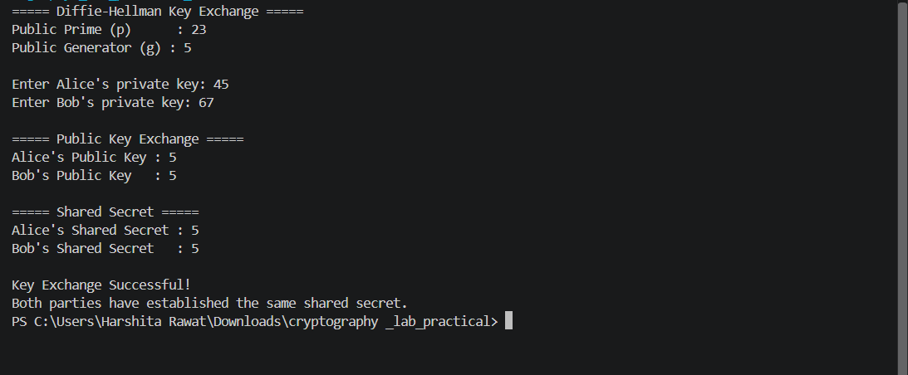

# Experiment 7: RSA and Diffie–Hellman Algorithms

## Aim

To implement the RSA and Diffie–Hellman cryptographic algorithms in Java and understand asymmetric encryption and secure secret-key exchange.

## Software/Tools Required

* Java Development Kit (JDK)
* Visual Studio Code (VS Code)

## Theory

**RSA Algorithm:**
RSA is an asymmetric encryption technique that operates using two different keys: a public key and a private key. The public key is used to encrypt data, while the corresponding private key is used to decrypt it.

**Diffie–Hellman Algorithm:**
Diffie–Hellman is a cryptographic key exchange technique that enables two parties to generate an identical shared secret over a public communication channel without sending the secret directly to each other.

## Working Procedure

### Part A: RSA Algorithm

1. Launch Visual Studio Code and create a Java file named `RSA.java`.
2. Initialize two prime numbers, `p = 61` and `q = 53`.
3. Compute the modulus `n = p × q` and Euler's totient value, `phi(n)`.
4. Choose a suitable public exponent and calculate its corresponding private exponent.
5. Provide a numerical message whose value is smaller than `n`.
6. Encrypt the message using the RSA public key.
7. Decrypt the encrypted value using the RSA private key.
8. Verify the correctness of the algorithm by comparing the original message with the decrypted result.

### Part B: Diffie–Hellman Algorithm

1. Create a Java source file named `DiffieHellman.java`.
2. Define the public prime number `p = 23` and generator `g = 5`.
3. Assign private keys to Alice and Bob.
4. Compute their respective public keys using modular exponentiation.
5. Exchange the public keys and independently calculate the shared secret on both sides.
6. Compare the shared secret values generated by Alice and Bob to confirm successful key exchange.

## Screenshots

### 1. RSA Execution Output

The output displays RSA key generation, encryption of the numerical message, and successful decryption.

### 2. Diffie–Hellman Execution Output

The output demonstrates the exchange of public keys and confirms that Alice and Bob independently generate the same shared secret.

## Security Analysis

* RSA illustrates asymmetric cryptography through the use of separate public and private keys for encryption and decryption.
* Diffie–Hellman explains how two communicating parties can establish a common secret without transmitting it directly.
* The small numerical values used in these programs are intended only for learning and demonstration purposes. They are not sufficiently secure for practical cryptographic applications.

## Result

The RSA algorithm was successfully implemented to encrypt and decrypt a numerical message, and the decrypted output matched the original input. The Diffie–Hellman algorithm was also executed successfully, with Alice and Bob independently generating an identical shared secret, demonstrating the working principles of secure key exchange.
