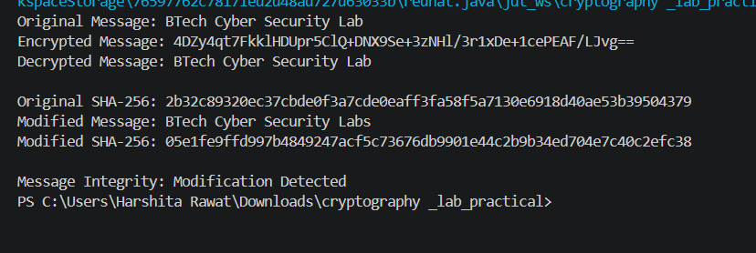

# Experiment 8: AES Encryption and SHA-256 Hashing

## Aim

To develop a Java program that performs AES encryption and decryption and verifies message integrity using the SHA-256 hashing algorithm.

## Software/Tools Required

* Java Development Kit (JDK)
* Visual Studio Code (VS Code)

## Theory

**AES (Advanced Encryption Standard):**
AES is a symmetric-key encryption algorithm that uses the same secret key to encrypt and decrypt data. In this experiment, AES-256 with GCM mode is used to provide secure message encryption and decryption. A randomly generated initialization vector (IV) is used during the encryption process.

**SHA-256 (Secure Hash Algorithm 256-bit):**
SHA-256 is a cryptographic hashing algorithm that produces a fixed-size hash value of 256 bits for any input message. Even a minor modification to the input generally results in a different hash value. Therefore, it is useful for verifying the integrity of data.

In this experiment, the hash values of the original and altered messages are generated and compared. If the values do not match, it indicates that the message content has been changed.

## Working Procedure

1. Create a Java source file named `SecureMessageDemo.java` in Visual Studio Code.
2. Generate a 256-bit AES secret key and a random initialization vector (IV).
3. Apply AES-GCM encryption to the original message.
4. Decrypt the encrypted data using the same secret key and IV.
5. Generate SHA-256 hash values for both the original message and the modified message.
6. Compare the generated hash values to check whether the message has been altered.
7. Print the encrypted data, decrypted message, hash values, and final integrity verification status.

## Screenshots

### AES Encryption and SHA-256 Execution Output

## Result

The Java program was executed successfully to perform AES-256 encryption and decryption using GCM mode. The encrypted data was converted into Base64 format for display and was successfully decrypted to recover the original message.

The SHA-256 hash values of the original and modified messages were also generated and compared. As the hash values were different, the program displayed **"Modification Detected"**, confirming that SHA-256 can help identify changes in message content.
