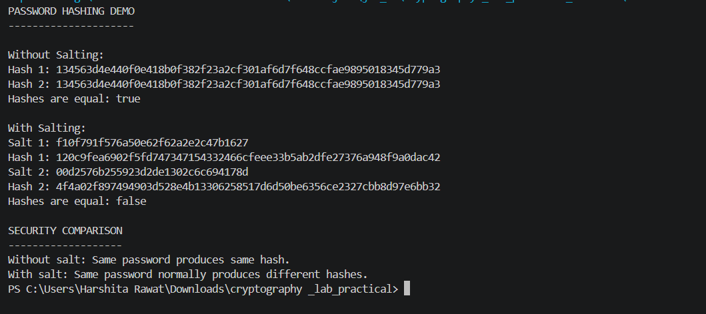

# Experiment 9: Password Hashing With and Without Salting

## 1. Aim

To develop a Java program that demonstrates password hashing with and without salting and analyze its effectiveness against common password attacks using Visual Studio Code.

## 2. Software/Tools Required

* Java Development Kit (JDK)
* Visual Studio Code (VS Code)

## 3. Theory

### 3.1 Password Hashing

Password hashing is a security method used to transform a password into a fixed-length hash value through a cryptographic hash function. Instead of saving passwords in their original form, systems store their hash values to enhance security. In this experiment, SHA-256 is used to demonstrate the password hashing process.

### 3.2 Password Hashing Without Salting

Without salting, a password is directly converted into a hash value using a hashing algorithm. As a result, entering the same password always generates the same hash. This makes it easier to recognize identical passwords and increases the risk of precomputed rainbow-table attacks against stored password hashes.

### 3.3 Password Hashing With Salting

Salting is a technique in which a random value, known as a salt, is combined with a password before hashing. When different salts are used, the same password generates different hash values. This reduces the effectiveness of rainbow-table attacks and makes it harder to identify users who have chosen identical passwords.

However, salting does not completely protect passwords from brute-force or dictionary attacks, especially when users choose weak passwords.

## 4. Working Procedure

1. Create a Java program named `PasswordHashing.java` using Visual Studio Code.
2. Import the necessary Java libraries for SHA-256 hashing and secure random number generation.
3. Declare a sample password to perform the experiment.
4. Generate the hash of the password twice without using a salt and compare both results.
5. Use `SecureRandom` to generate two different random salt values.
6. Combine the password with each salt and calculate the corresponding hash values.
7. Compare the resulting salted hashes and observe the differences.
8. Analyze how salting improves security and examine its limitations against common password attacks.

## 5. Screenshots

### Password Hashing Execution Output

## 6. Comparison Against Password Attacks

| Security Aspect                        | Without Salting | With Salting                                    |
| -------------------------------------- | --------------- | ----------------------------------------------- |
| Same password produces the same hash   | Yes             | No, when different salts are used               |
| Resistance to rainbow-table attacks    | Low             | Significantly improved                          |
| Detection of reused passwords          | Easier          | More difficult                                  |
| Protection against brute-force attacks | Vulnerable      | Still vulnerable                                |
| Security for weak passwords            | Limited         | Limited                                         |
| Suitability for production use         | Not recommended | Requires a dedicated password-hashing algorithm |

Salting enhances password security by making precomputed rainbow-table attacks less effective. However, it cannot prevent attackers from guessing weak passwords. For real-world applications, specialized password-hashing algorithms such as Argon2id, bcrypt, and scrypt are recommended.

## 7. Result

The Java program was successfully executed in Visual Studio Code to demonstrate password hashing with and without salting. It was observed that hashing the same password without a salt produced identical hash values, whereas using different random salts generated different hash values.

The experiment demonstrated that salting improves password security by reducing the effectiveness of rainbow-table attacks and making the identification of identical passwords more difficult. Nevertheless, brute-force and dictionary attacks can still succeed against weak passwords. Therefore, dedicated password-hashing algorithms are preferred for secure password storage.
